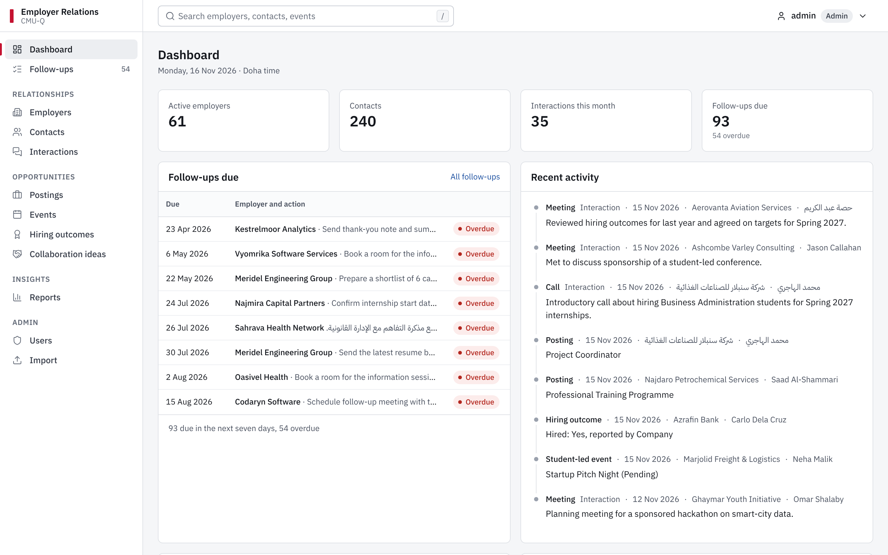
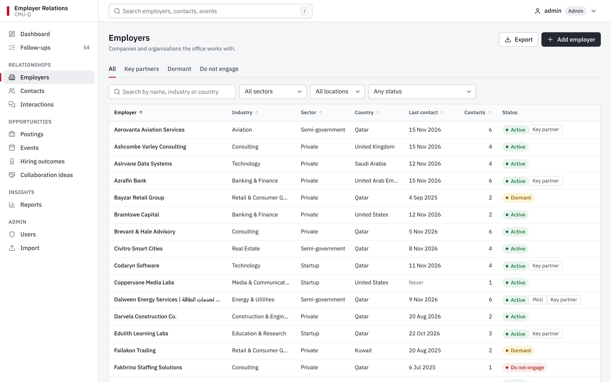
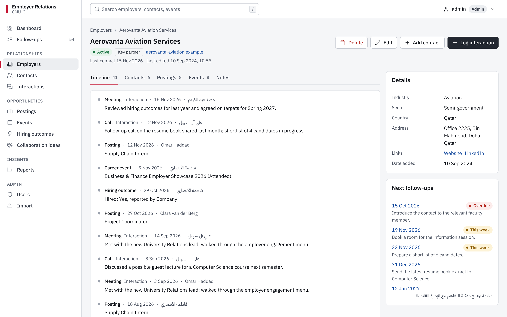
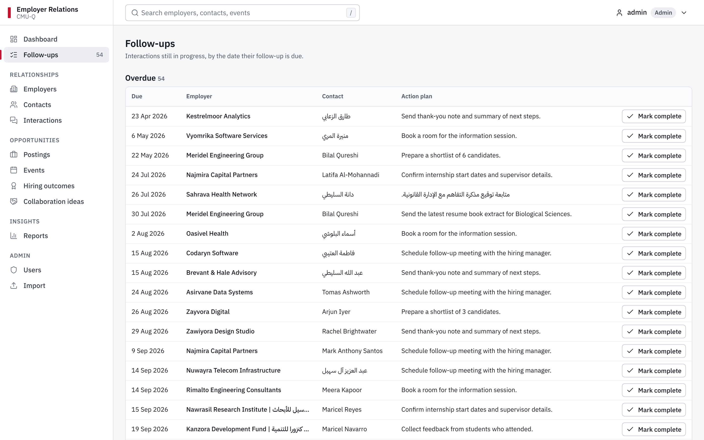
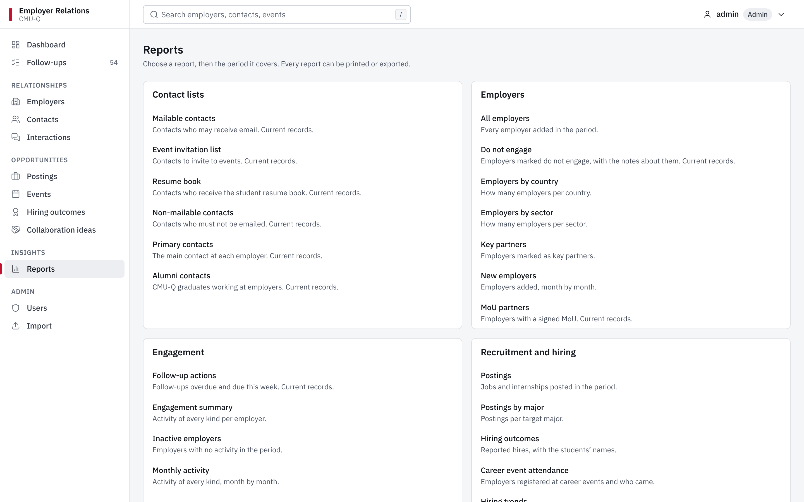
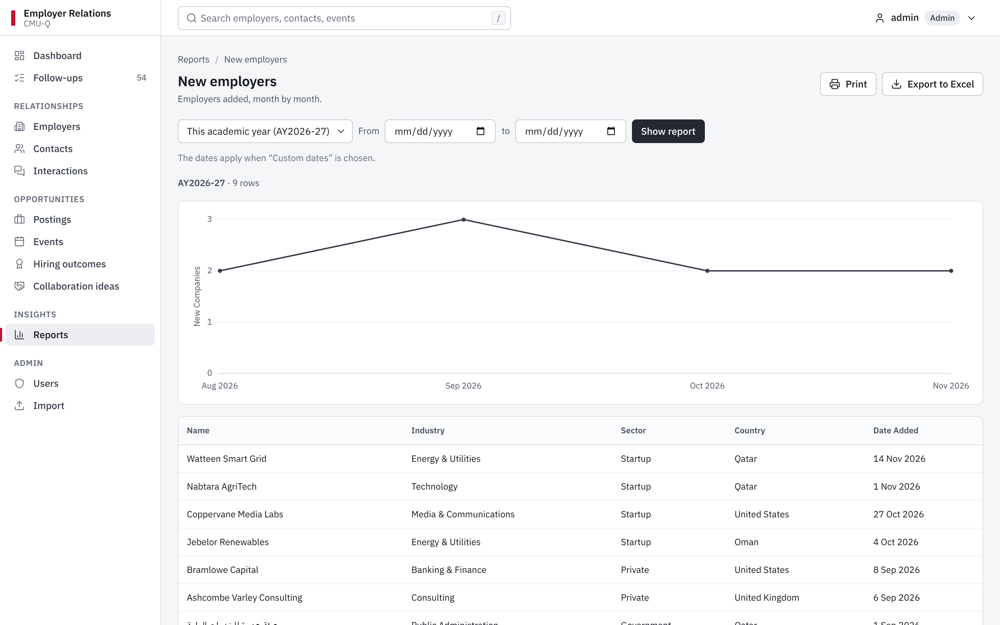
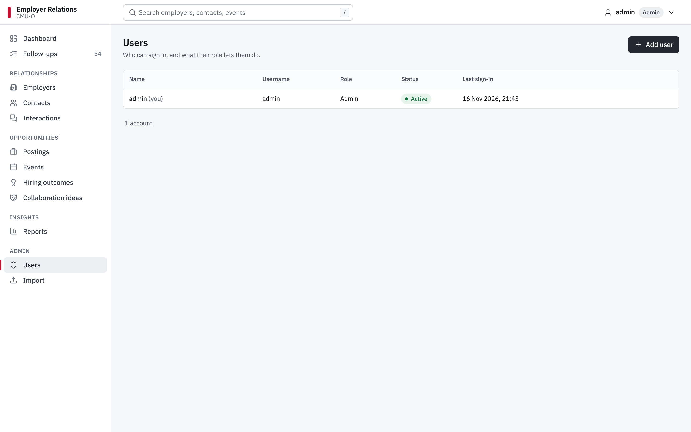
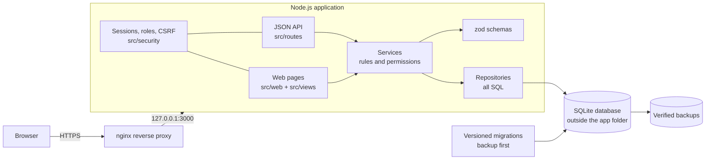

# Employer Relations CRM

A relationship management system for the Employer Relations Office at Carnegie Mellon University in Qatar.

[](https://github.com/M-Elosta/CRM_StudentAffaris/actions/workflows/ci.yml)




> Every screenshot in this repository shows fictional demonstration data. No real employer, contact or student appears anywhere in the code, tests or images.

## Overview

The Employer Relations Office works with several hundred employers in Qatar, the Gulf and abroad: who the contacts are, what was discussed, which internships and jobs were posted, who came to which career event, and what happened afterwards. This system keeps all of that in one place. Staff see each employer's full history on a single page, know which follow-ups are due, and can answer leadership's questions with a report instead of a spreadsheet hunt. It handles Arabic and English text throughout.

## Key features

### Employer management

One profile per employer with its contacts, a single timeline of every interaction, posting and event, and the next follow-ups. Lists are searched, filtered, sorted and paged on the server, so they stay fast as the data grows. Arabic and English names can be searched and are displayed correctly side by side.





### Follow-ups

Every open interaction with a follow-up date appears in one list, grouped into overdue, this week and later. The dashboard and the sidebar show how many are overdue.



### Reporting

More than thirty reports, grouped by subject: contact lists, employers by sector and country, activity by month and semester, postings by programme, event attendance, hiring outcomes, and year-over-year comparisons. Each report takes a date range, can be printed, and can be exported to Excel by roles that are allowed to export.





### Security

Four roles (Admin, Staff, Read-only, Student Worker) enforced on the server for every read and write, including which fields a role may see. Personal contact details and student data are withheld from Student Workers. Sessions are stored in the database, expire when idle, and are checked against the user's account on every request, so removing someone's access takes effect at once.

### Admin

Administrators add users, change roles, and deactivate or reactivate accounts. Bulk import from Excel shows a preview with per-row errors and likely duplicates before anything is saved.



## Tech stack

| Layer         | Choice                                                                           |
| ------------- | -------------------------------------------------------------------------------- |
| Runtime       | Node.js 22 LTS                                                                   |
| Web framework | Express 4                                                                        |
| Database      | SQLite (WAL mode, foreign keys enforced) through `better-sqlite3`                |
| Pages         | Server-rendered Nunjucks templates, htmx for partial updates                     |
| Styling       | One hand-written stylesheet, IBM Plex Sans and IBM Plex Sans Arabic, self-hosted |
| Charts        | Chart.js, self-hosted                                                            |
| Validation    | zod                                                                              |
| Tests         | Node's built-in test runner, supertest                                           |

There is no build step and nothing is loaded from a CDN.

## Quick start

Requires Node.js 22.

```bash
git clone https://github.com/M-Elosta/CRM_StudentAffaris.git
```

```bash
cd CRM_StudentAffaris
```

```bash
npm ci
```

```bash
npm run seed:demo
```

```bash
npm start
```

Open `http://127.0.0.1:3000`. On the first start the terminal prints the administrator's username and a generated password. The development database is created at `data/dev/employer.db`. To change any setting, copy `.env.example` to `.env`.

Useful commands:

| Command                        | What it does                                                          |
| ------------------------------ | --------------------------------------------------------------------- |
| `npm test`                     | Runs the test suite                                                   |
| `npm run lint`                 | ESLint                                                                |
| `npm run format:check`         | Prettier check                                                        |
| `npm run migrate:status`       | Shows applied and pending database migrations                         |
| `npm run seed:demo -- --reset` | Wipes the development database and reseeds the demo data              |
| `npm run backup`               | Takes a verified backup of the database                               |
| `npm run screenshots`          | Regenerates `docs/screenshots/` from the demo data (needs Playwright) |

## Deployment, single sign-on and backups

The target is a Linux VM run by CMU-Q IT: Node.js under systemd as a non-root service user, behind nginx with HTTPS.

- **Configuration** is entirely through environment variables. [`.env.example`](.env.example) documents each one. Staging and production refuse to start without an explicit database path, backup directory and session secret, so data never ends up inside the application folder.
- **Database migrations** are versioned and run automatically at start. Before any migration touches a database that holds data, a verified backup is taken, and a migration that would lose rows is rolled back.
- **Backups**: `npm run backup` produces a verified, self-contained copy of the database. Encrypted off-server backups with retention, a tested restore script, and the install and one-command deploy scripts are in progress on the `feature/ops-tooling` branch.
- **Single sign-on** (CMU Shibboleth or Microsoft Entra ID) is planned. The account schema already carries the fields it needs. Until then, sign-in is by username and password.

[`PROGRESS.md`](PROGRESS.md) lists exactly what is finished and what is not.

## Architecture



Requests enter through thin page controllers or the JSON API. Both call the same services, which hold every business rule and every permission check, so a rule cannot be bypassed by using a different entry point. Only repositories contain SQL, and all of it is parameterised. The database is a single SQLite file: there is no database server for IT to install or patch, and a backup is one file.

## Security overview

In place:

- Role-based access control enforced in the services, with a permission matrix pinned by tests
- Sensitive fields withheld by role in every response, and not searchable by roles that cannot see them
- Sessions stored server-side with hashed identifiers, idle and absolute timeouts, immediate revocation
- CSRF tokens on every form; origin check on the JSON API
- Content Security Policy without inline scripts, inline styles or third-party origins
- Input validated on every route; parameterised SQL only
- Rate limiting on sign-in and on the API
- Dependencies pinned, `npm audit` clean, Dependabot configured

Not yet in place: single sign-on, multi-factor authentication, the audit log, soft delete and restore, and the privacy tools (export or erase one person's data). The database schema for these already exists.

To report a security problem, use [private vulnerability reporting](https://github.com/M-Elosta/CRM_StudentAffaris/security/advisories/new) rather than a public issue.

## Project structure

```text
src/
  server.js          entry point: config, migrations, start, shutdown
  app.js             Express application factory
  config/            environment-based configuration
  db/                connection, migrations, backups, repositories
  domain/            record type definitions and value lists
  services/          business rules, reports, import
  security/          permissions, sessions
  validation/        zod schemas
  routes/            JSON API
  web/               page controllers
  views/             Nunjucks templates
public/assets/       stylesheet, icons, client script
scripts/             migrate, backup, demo seed, screenshots, route check
tests/               unit and integration tests
docs/                audit, decisions, screenshots
```

## Roadmap

- Single sign-on (SAML and OIDC) with a local break-glass login protected by TOTP
- Audit log, soft delete with restore, and record history
- Encrypted off-server backups, restore drill, install and deploy scripts with automatic rollback
- Tasks, notes, tags and a relationship owner per employer
- Saved list views and saved report filters
- Duplicate detection and merge
- Email reminder digest

The background to these choices is in [`docs/AUDIT.md`](docs/AUDIT.md) and [`docs/DECISIONS.md`](docs/DECISIONS.md).

## Licence

No licence has been chosen. This software may be the property of Carnegie Mellon University in Qatar; ownership needs to be confirmed before a licence is added. Until then, all rights are reserved.

## Credits

Built by Mohamed Elosta for the Employer Relations Office at Carnegie Mellon University in Qatar.
